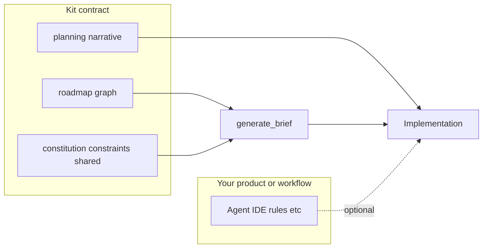

# Philosophy and scope

This document is for **humans and coding agents** adopting or working on specy-road. It states what the kit is **opinionated** about and what it **does not** prescribe.

## What specy-road is opinionated about

- **Roadmap-first evolution** — The graph under `roadmap/` ([`manifest.json`](../specy_road/templates/project/roadmap/manifest.json) + ordered **JSON** chunk files) is canonical: immutable milestone IDs, dependencies, gates, codenames, and touch zones.
- **Separation of concerns** — [`constitution/`](../specy_road/templates/project/constitution/purpose.md) holds purpose and principles (human judgment). [`constraints/`](../specy_road/templates/project/constraints/README.md) holds enforceable, checkable rules. Operational detail belongs in constraints and contracts, not in aspirational prose.
- **Contracts over tribal knowledge** — [`shared/`](../specy_road/templates/project/shared/README.md) holds specs and policies that tasks **cite**; implementation work ties back to those files instead of duplicating intent in chat.
- **Multi-agent safety** — [`roadmap/registry.yaml`](../specy_road/templates/project/roadmap/registry.yaml) plus touch zones and registration on the integration branch ([`git-workflow.md`](git-workflow.md)) make parallel work visible before conflicts.
- **Separated roles and recorded review** — Whoever implements a leaf does not review or approve it. Reviews are files bound to the commit they read ([`orchestration.md`](orchestration.md)), and the review gate counts them against [`roadmap/orchestration.yaml`](../specy_road/templates/project/roadmap/orchestration.yaml) — a coordinator cannot approve its own work.
- **Harness and model are distinct** — A worker is launched on a named harness (`claude-code`, `codex`, `cursor`, or your own command) with a named model; the record keeps both, one writer holds the session at a time, and what a harness cannot do (interrupt a one-shot run) is reported as unsupported, never emulated ([`orchestration-workers.md`](orchestration-workers.md)).
- **Ideas are evidence-bearing records** — `brainstorm` keeps every idea with its origin, cluster, sources (quote, URL, verification state) and the human's decision in a tracked session file; the agent advises, the human decides ([`brainstorming.md`](brainstorming.md)).
- **Harness-native, no model calls** — The coordination CLI (claims, briefs, workers, the review gate, brainstorm sessions) never calls a model or search API; the harness does. The named exceptions are the opt-in `review-node` command (an advisory LLM review against your own API key), `brainstorm verify` (fetches one URL and asks first), and the GUI's configured search and LLM providers. specy-road reaches each harness through one-shot CLI adapters, hooks and skills — no daemon, no MCP server — and augments the harness's own tools, skills and review commands with roadmap-specific prompts and records instead of reinventing generic agent tooling ([`design-notes/v0-3-1-worker-orchestration.md`](design-notes/v0-3-1-worker-orchestration.md)).
- **Planning as narrative spine** — Nodes with **`planning_dir`** point at a **single** feature sheet [`planning/<id>_<slug>_<node_key>.md`](../specy_road/templates/project/planning/README.md) in the repo. Session scratch and generated briefs may still live under [`work/`](../specy_road/templates/project/work/README.md).

## What specy-road does not prescribe

- **Which coding agent or IDE** you use (Cursor, Claude Code, Copilot, none, etc.), or which model fills the coordinator, executor, or reviewer role.
- **How** an agent plans or implements inside a session (step lists, tool choice, prompts). That is between the user and their harness; specy-road adds roadmap-specific prompts and records on top of the harness's own tools and does not ship generic agent tooling of its own.
- **Product-specific stacks** — The roadmap describes *what* and *which contract*; stack choices belong in your application’s ADRs and contracts under `shared/` (or your app repo), not in the kit’s core rules.

Optional patterns for teams that *want* IDE rules, `CLAUDE.md`, their own MCP servers, or similar are collected in [`optional-ai-tooling-patterns.md`](optional-ai-tooling-patterns.md). Those patterns are **not** part of specy-road’s contract, and specy-road ships none of that tooling itself: it uses the harness's tools and augments them.

**Required vs optional glue:** Anything that defines roadmap truth, contracts, or enforceable limits lives under `constitution/`, `constraints/`, `roadmap/`, and `shared/` in **your** project and is driven by the **specy-road** CLI (`validate`, `brief`, `export`, `file-limits`, …). The optional **`specyrd init`** helper only installs thin skills (`.agents/skills/<name>/SKILL.md`, read by Cursor and Codex directly and by Claude Code through `.claude/skills/` symlinks; a flat directory of stubs for `--ai generic`) that **point at** those commands; it does not replace them or duplicate kit rules in editor-only files.

## Relationship to Spec-Kit

[Spec-Kit](https://github.com/github/spec-kit) is a useful reference for spec discipline and context hygiene. specy-road is **not** Spec-Kit; it emphasizes a **roadmap graph + registry** and leaves agent-side workflows flexible.

## Agent load order (keep context small)

Coding agents should read in this order (see also [`../AGENTS.md`](../AGENTS.md); consumer scaffold paths match [`specy-road init project`](install-and-usage.md#initialize-a-new-consumer-project)):

0. `roadmap-context.md` (generated by `specy-road digest`) — read it before crawling `planning/` or `work/`
1. [`constitution/purpose.md`](../specy_road/templates/project/constitution/purpose.md)
2. [`constitution/principles.md`](../specy_road/templates/project/constitution/principles.md)
3. [`constraints/README.md`](../specy_road/templates/project/constraints/README.md)
4. `docs/supply-chain-security.md` — dependency verification policy
5. Merged roadmap graph ([`roadmap/manifest.json`](../specy_road/templates/project/roadmap/manifest.json) + `includes` chunk files) — **your node** plus parents and `dependencies` only
6. **[Feature sheets under `planning/`](../specy_road/templates/project/planning/README.md)** — read **ancestor** sheets (phase/milestone) for context, then **this node’s** `planning_dir` file
7. [`shared/README.md`](../specy_road/templates/project/shared/README.md) — then open **only** contract files cited for the task

Contributors working on the **specy-road toolkit** repository follow the load order in [`AGENTS.md`](../AGENTS.md). The dogfood tree under [`tests/fixtures/specy_road_dogfood/`](../tests/fixtures/specy_road_dogfood/) is a test-fixture roadmap used for validation and sample flows, not the toolkit's canonical product roadmap.

For a focused slice:

```bash
specy-road brief <NODE_ID> -o work/brief-<NODE_ID>.md
```

## Flow (high level)



The kit supplies the **roadmap graph** (JSON manifest + chunk files under `roadmap/`), **planning/** feature sheets, constitution, constraints, and **shared** contracts. **Implementation** happens in your codebase; optional agent/IDE configuration is outside the kit’s required surface.
