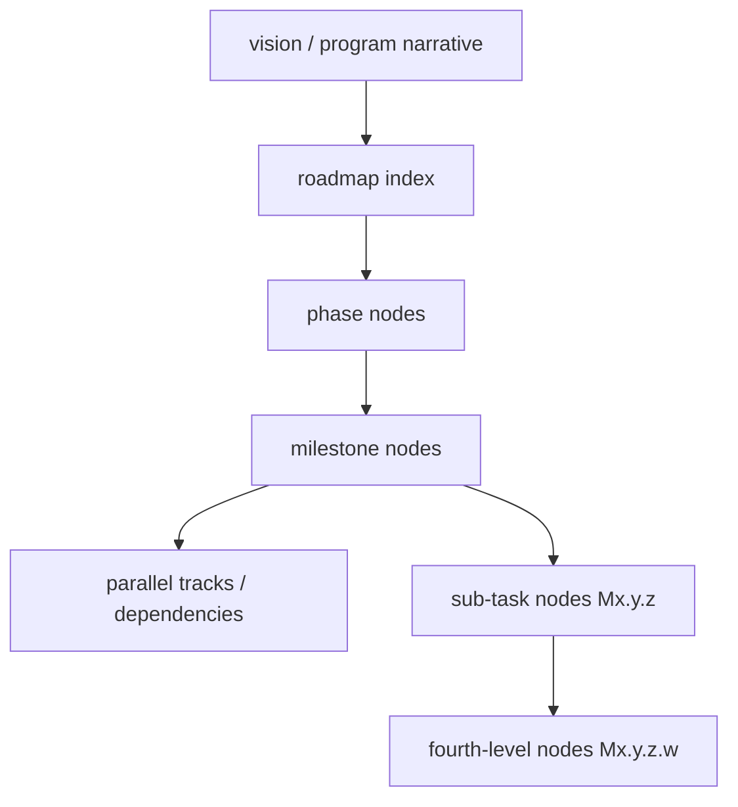

# Roadmap authoring: JSON manifest and chunk files

## Agent quickstart

**Use this doc when:** you add, edit, move or renumber roadmap nodes, or need the field rules for `roadmap/manifest.json` and its JSON chunks.
**Not for:** the PM's day-to-day loop and dashboard ([`pm-workflow.md`](pm-workflow.md)) or claiming and finishing leaves ([`dev-workflow.md`](dev-workflow.md)).

**Must know without reading on:**
- Identity is `node_key` (UUID, immutable); `dependencies` store other nodes' `node_key` values, never display ids (`add-node --dependency`, `add-dependency` and `apply` take a display id and store its key). Display `id` may be renumbered; never recycle a `node_key`.
- `roadmap.md` is generated: edit chunks, then `specy-road export` (`--check` in CI); `specy-road validate` is the gate after every edit.
- Prefer `specy-road add-node` / `edit-node` / `set-dependencies` (or `apply` for a batch) to hand-editing chunks: routing picks the chunk, and `specy-road rebalance-chunks` fixes one over the 500-line cap.
- Every `vision`, `phase`, `milestone`, `task` and `gate` node needs `planning_dir` → `planning/<id>_<slug>_<node_key>.md`; contracts are cited in that sheet's `## References`, not in the JSON.
- A `type: gate` node is a leaf-only hold: never picked up, never in `roadmap/registry.yaml`, and it blocks its dependents until `Complete`.

**Read further for:**
- where the graph lives, what each `type` means, manifest, chunk shape, the line cap, routing → "Source of truth", "Roadmap layers", "JSON chunks (`.json`)"
- `parent_id`, `sibling_order`, renumbering, planning-file renames → "Reordering and reparenting"
- every field, gates, decision blocks → "Node fields reference"
- `execution_milestone` and sub-task tagging → "Execution type tagging"
- the five questions a sheet answers, `## References`, vendor-neutral wording, spec types → "Writing implementable `agentic` tasks", "Stack-agnostic task language", "Spec crosswalk"
- registry etiquette, the PM edit steps, export, CRUD, brief → "Multi-agent coordination", "PM editing workflow", "Generated index (`roadmap.md`)", "Tooling", "Registry and brief"
- recurring deep research under `research/` and folding its findings into the roadmap → "Research register"

**Related:** [`pm-workflow.md`](pm-workflow.md), [`dev-workflow.md`](dev-workflow.md), [`archiving.md`](archiving.md), [`git-workflow.md`](git-workflow.md).

## Source of truth

**Canonical for a specy-road project:** the roadmap graph under that project's `roadmap/`. In this toolkit repository, the examples and links point at the dogfood **test fixture** under [`tests/fixtures/specy_road_dogfood/roadmap/`](../tests/fixtures/specy_road_dogfood/roadmap/); consumer projects keep the same structure at their own repo root. The entry file is **required**: [`roadmap/manifest.json`](../tests/fixtures/specy_road_dogfood/roadmap/manifest.json) with `version` and `includes` — an ordered list of **JSON** chunk paths relative to `roadmap/`. Each chunk file holds a `nodes` array (or a single-node shape accepted by the loader); see [JSON chunks](#json-chunks-json).

Display **`id`** values may be **renumbered** when outline operations rewrite the tree; stable identity is always **`node_key`** (UUID). Gaps in numbering are allowed; do not recycle or collide **`node_key`** values. (See [Display `id` vs stable `node_key`](#display-id-vs-stable-node_key) below.)

### PM vocabulary vs schema `type`

The schema uses small enums; this is how they usually map to product thinking:

| Schema `type` | Typical PM meaning |
|---------------|-------------------|
| `phase` | A major arc or release train (often spans multiple deliverables). |
| `milestone` | A shippable slice or **feature**-sized outcome (codename, touch zones, dependencies). |
| `task` | **Sub-feature** or implementation slice. |
| `vision` | Program-level narrative when you use that layer. |

Dependencies and `parallel_tracks` express what can run in parallel vs what must wait — not the `includes` order alone.

## Roadmap layers

The graph has a natural depth hierarchy. **Node definitions** live in chunk files under `roadmap/`; [`roadmap.md`](../tests/fixtures/specy_road_dogfood/roadmap.md) is a **generated index** for reading.



| Layer | Node `type` | Role |
|-------|-------------|------|
| **Vision** | `vision` | Why the project exists; principles and metrics. |
| **Phase** | `phase` | Time-bounded arc; execution milestone gate. |
| **Milestone** | `milestone` | Atomic delivery unit in the index status table; goal, acceptance, codename, touch zones. |
| **Parallel tracks / dependencies** | (node fields) | Concurrent vs. sequenced work — set `parallel_tracks` and `dependencies`. |
| **Sub-tasks** | `task` (depth 3) | Checklist granularity. **Immutable** IDs. |
| **Fourth-level** | `task` (depth 4) | Additive only; same immutability rules as sub-tasks. |

## JSON chunks (`.json`)

Keep the graph **logically split** across multiple files under `roadmap/` so each file stays small and **diff-friendly in git**.

### Manifest (`manifest.json`)

- **`version`** — integer (schema expects `1`).
- **`includes`** — ordered list of chunk paths relative to `roadmap/` (e.g. `phases/M0.json`, `phases/M1.json`).

Validated by [`schemas/manifest.schema.json`](../tests/fixtures/specy_road_dogfood/schemas/manifest.schema.json). Do not add a top-level `nodes` key to the manifest — nodes live only in chunk files.

**PM ordering:** `includes` order controls **merge order** when the loader concatenates chunk `nodes` arrays (and affects diffs and narrative flow in some tools). It does **not** define which actionable **leaf** `specy-road do-next-available-task` auto-picks among equally eligible work — that follows **outline (tree) order** (see [Reordering and reparenting](#reordering-and-reparenting)). **Gating** (what may start) is still driven by each node’s `dependencies` and `status`. The generated [`roadmap.md`](../tests/fixtures/specy_road_dogfood/roadmap.md) index uses its **own** sort on display `id` for reading; that sort is not the same as merge list order or auto-pick order.

### Chunk shape

Recommended on-disk shape (stable key order when tools save):

```json
{
  "nodes": [
    {
      "dependencies": [],
      "id": "M0",
      "parent_id": null,
      "status": "Complete",
      "title": "Foundation",
      "type": "phase"
    }
  ]
}
```

The loader also accepts a top-level JSON **array** of node objects, or a single object with an `id`. Validation uses [`schemas/roadmap.schema.json`](../tests/fixtures/specy_road_dogfood/schemas/roadmap.schema.json) on the **merged** graph.

Use the `notes` field (markdown string) for short context in the graph. **Vision, phase, milestone, and task** nodes must set **`planning_dir`** to a single feature sheet path: `planning/<id>_<slug>_<node_key>.md` — see [`planning/README.md`](../tests/fixtures/specy_road_dogfood/planning/README.md).

### Line-count policy (~500)

- **Manifest** [`manifest.json`](../tests/fixtures/specy_road_dogfood/roadmap/manifest.json): keep small; limit from `roadmap_manifest_max_lines` in config.
- **JSON chunks** under `roadmap/` (except `manifest.json`): may not exceed **`roadmap_json_chunk_max_lines`** (default **500**) unless the chunk contains **exactly one** node.

[`registry.yaml`](../tests/fixtures/specy_road_dogfood/roadmap/registry.yaml) is separate from the graph and is not a merge chunk. Enforced by `specy-road validate` (via [`specy_road/bundled_scripts/roadmap_load.py`](../specy_road/bundled_scripts/roadmap_load.py)). Configure limits in [`constraints/file-limits.yaml`](../constraints/file-limits.yaml) in **your** project (or the toolkit’s [`constraints/file-limits.yaml`](../constraints/file-limits.yaml) when working on this repository).

**Canonical key order.** Every tool write (`add-node`, `edit-node`, the PM Gantt, `finish-this-task`, `rebalance-chunks`) re-renders the **whole** chunk it touches in one canonical form: a `{"nodes": [...]}` object, keys sorted alphabetically inside every node, 2-space indent, UTF-8, trailing newline. Nodes keep their chunk and their position in it; only the text changes. So the **first** tool edit of a hand-authored chunk rewrites all of it — every node's keys move, even though one field changed — and from then on diffs stay confined to the fields that actually changed. To take that one-time rewrite on purpose, in its own commit rather than inside an unrelated edit, run `specy-road rebalance-chunks --normalize [--dry-run]`: it rewrites every included chunk in canonical form without moving a node between or within chunks, leaves `manifest.json` alone, validates, and is a no-op when every chunk is already canonical.

### Automatic chunk routing (no daily commands)

Writes that add a node (`add-node`, PM Gantt add-task, `edit-node` when growth pushes a chunk over the cap) go through an **automatic chunk router**. PMs no longer pick a chunk or split full chunks. Routing (deterministic): hint chunk if it fits → **a phase root gets its own chunk named after it** (`phases/M2.json`, in the directory of the first manifest include) → smallest valid chunk in the same phase subtree (manifest-order tie-break) → smallest valid chunk anywhere → auto-create a new chunk named `<base-stem>__<6hex>.json` where `<6hex>` is the new node's `node_key` prefix (same key → same filename; different keys → different filenames, so concurrent PMs never collide on chunk files — only the manifest gets a trivially-mergeable add). The phase-root step exists because a phase has no phase *ancestor*, so the locality step cannot apply to it; without a rule of its own it would be packed into a sibling phase's file and its whole subtree would follow. A name already in `includes`, or already present on disk, is treated as taken and routing continues to the next step. All mutations run in an atomic plan that snapshots every affected file and rolls back on validation failure. That plan covers everything the mutation touches — the chunk, the manifest, an overflow relocation, **and the node's planning sheet** (created on `add-node`, renamed when an edit changes `planning_dir`, removed on `archive-node --hard-remove`) — so a refused command leaves the working tree byte-for-byte as it was. `--chunk` on `add-node` is now optional (still accepted as a hint). Existing repos stay byte-identical until the next mutation triggers an auto-create.

**When a chunk is already over the cap** (for example after hand-editing, or after importing a roadmap), `specy-road rebalance-chunks [--dry-run]` re-packs every chunk deterministically and updates the manifest. It is idempotent and not needed for routine authoring, but it is the supported answer to `roadmap line limit: … lines (max …)` — you should not need to split JSON by hand.

**Milestone-lock interaction.** Both `specy-road add-node` and `specy-road rebalance-chunks` honor the milestone subtree lock added in v0.1.0. Adding a child under a parent that lives inside an `active` or `pending_mr` milestone subtree is refused (it would be a silent scope expansion on a live rollout). `rebalance-chunks` refuses with exit 1 when ANY milestone is in-flight (the cross-chunk reorganization is functionally a mutation under any locked subtree, and would also confuse the PM Gantt's optimistic-concurrency fingerprint). Both errors point at `specy-road reconcile-milestone-status --apply`. Close the milestone after delivery, then retry.

## Reordering and reparenting

### Single source of truth: identity vs on-disk layout

| Question | Source of truth |
|----------|-----------------|
| Who is this node forever? | **`node_key`** (UUID) — never rename or recycle. |
| What must `dependencies` reference? | Other nodes’ **`node_key`** values (not display `id`). |
| What do humans and the CLI type for `brief`, registry, branch context? | Display **`id`** (`M…`) and [`registry.yaml`](../tests/fixtures/specy_road_dogfood/roadmap/registry.yaml) `node_id` — must match the node’s current **`id`**. |
| Where does “tree order” for siblings live? | **`parent_id`** + **`sibling_order`** (outline tools and renumbering use these; siblings sort by `(sibling_order, id)`). Prefer **unique consecutive `sibling_order`** per parent so tie-breaks do not depend on display `id` strings. |
| What `sibling_order` does a new node get? | **`add-node`** appends it after the parent's current last sibling (an unset value sorts as `0`, which used to jump the queue); `--sibling-order N` places it explicitly. |
| What encodes the planning file path? | **`planning_dir`** → `planning/<id>_<slug>_<node_key>.md` — the **display `id`** appears in the filename; when `id` changes, update `planning_dir` and rename the file (see below). |

**Disk layout:** Chunk file placement and `manifest.json` **`includes`** order only affect how the merged **`nodes` array** is built. They do **not** change `node_key` or dependency edges by themselves.

### Supported workflow

1. **Reparent or reorder** via the PM UI or `specy-road` CRUD by editing **`parent_id`** and **`sibling_order`**. Do **not** mint new `node_key` values or rewrite **`dependencies`** unless you are splitting/merging nodes or intentionally changing gates.
2. **Move a node with `specy-road move-node <ID> --to-parent <P>`** (`null` for the roadmap root). By default only the moved subtree's ids change: the node takes the next free id under `P` (one past the highest existing child number, so `M2.1`, `M2.4` gives `M2.5`; gaps are allowed and never closed) and each descendant keeps its own last segment under the new id (`M1.2.4` becomes `M2.5.4`). No sibling's or other milestone's display id, planning-sheet name or registry `node_id` changes, so ids cited in sheets, acceptance and notes stay true. `--id NEW` gives the moved node a chosen id instead: `NEW` must match `^M[0-9]+(\.[0-9]+)*$`, be `P` plus exactly one numeric segment (`Mk` at the root) and not be used by any node outside the moved subtree. `--fill-gaps` takes the lowest unused child number under `P` instead, from 1 (at the root from 0 when any node is `M0`, the moved one included, else 1), ignoring the moved subtree's ids when looking for a free one, so moving `M0` at the root keeps `M0` (`M2.1`, `M2.4` gives `M2.2`). Both change only the moved subtree's ids, like the default. `--id` and `--fill-gaps` are mutually exclusive and neither combines with `--renumber-outline`; each refusal exits 1 naming the reason and writes nothing. `--index N` sets the position among the new siblings (outline order) without changing that id. `--renumber-outline` instead renumbers every display id in the roadmap from the tree shape, closing the gaps; any node, not only the moved subtree, may then change id, sheet name and claim. The PM UI uses the same implementation: its outline drag (`POST /api/outline/move`, which also takes optional `new_id` and `fill_gaps`), **indent** and **outdent** change only the moved subtree's ids, and a sibling **reorder** (`POST /api/outline/reorder`) changes `sibling_order` only and no id; these four (move, reorder, indent, outdent) renumber the whole outline only when the request passes `renumber_outline: true`. **Add** (`POST /api/nodes/add`) always preserves every existing id: the new node takes the next free id under its parent, or a requested free `new_id`, and add has no `renumber_outline` option. Either form prints the `old -> new` map and, in the same transaction, renames the renumbered nodes' planning sheets and, in those nodes and the registry claims whose `node_id` is one of them, updates `node_id` and rewrites touch-zone path segments equal to an old id; a plain move rewrites nothing outside the moved subtree (another node's zone that names a moved id is left as written), while `--renumber-outline` rewrites such segments on every node and claim so a zone keeps naming the node it named; history records a `renumbered` event only for nodes whose id changed. `edit-node --set parent_id=` moves the edge alone and leaves the id behind. **Re-level with `specy-road indent <ID>`, `outdent <ID>` and `group-nodes`.** `indent` nests the node under the sibling above it and `outdent` makes it the sibling after its parent; they run the PM UI's indent and outdent, change only the moved subtree's ids and print the `old -> new` map. With nothing to do they exit 1 printing `no previous sibling` (indent) or `already at root` (outdent) and write nothing. `group-nodes --into-new NEW_ID --title T [--type milestone] ID...` creates a parent and moves the listed siblings under it: the ids must be distinct siblings and `NEW_ID` a free, well-formed child id of their parent (the `--id` rule above), else it is refused and nothing changes. The new parent takes the earliest listed sibling's position and gets a codename and planning sheet derived as `add-node` derives them; its children become `NEW_ID.1` to `NEW_ID.N` in argument order, and their descendants keep their suffixes. The whole group is one transaction validated once, however many siblings it moves. `POST /api/outline/group` is the same operation (body `into_new`, `title`, `node_ids`, optional `type`; 200 `{"ok": "true", "id_map": {old: new}}`; 400 `{"detail": ...}` for unknown or refused input). **Renumber display ids** when needed using outline renumber (e.g. full-tree rewrite from tree shape). Stable **`node_key`** and **`dependencies`** (UUID lists) stay the same; display **`id`** values update. Roots keep the project's numbering base: a roadmap with a root `M0` renumbers from `M0`, any other (such as the `init project` scaffold) from `M1`.
3. **Planning sheets:** After **`id`** or codename changes, ensure each node’s **`planning_dir`** matches the canonical pattern (see [`planning_filename_for_node`](../specy_road/bundled_scripts/planning_artifacts.py)). Outline operations in this kit call [`sync_planning_artifacts`](../specy_road/bundled_scripts/sync_planning_artifacts.py) to rewrite paths and rename files under `planning/`. You can also use `specy-road scaffold-planning` for new sheets. Manual edits should end with `specy-road validate`. **`specy-road do-next-available-task`** skips a leaf whose sheet still has scaffold-planning's or brainstorm promote's placeholder under **`## Intent`** or **`## Approach`**, even when the node has **`acceptance`** (same set as `grind-session --plan` / `orchestrate plan` list as `unauthored`); write those sections and commit the sheet, or pass **`--allow-scaffold-planning`** to pick anyway (finish still refuses unless that flag is passed there too). Leaves with no **`acceptance`** and a placeholder sheet are skipped separately; **`--allow-unauthored`** picks those. `specy-road validate` lists those as a stdout notice that **`--strict`** does not count, so planning roadmap-first passes the gate; **`--strict-authoring`** counts them as warnings again. `specy-road brief` prints one line, not the placeholder text, for a dependency or ancestor whose **`## Intent`** is still unwritten.
4. **Registry:** Active entries must use the current display **`id`** in **`node_id`**. If you renumber **`id`**, update open claims or `specy-road validate` will fail with an unknown `node_id`.
5. **Validate:** Run `specy-road validate` — it checks unique `id`/`node_key`, valid parents and dependency keys, DAG (no cycles), planning paths and filenames, and registry references.

### Chunk moves without changing the tree

Moving a node’s JSON from one chunk file to another or changing **`includes`** order **does not** change **`parent_id`**, **`sibling_order`**, **`node_key`**, or **`dependencies`**. Auto **do-next** order (outline-based) stays the same for the same eligibility snapshot.

### Example: renumber display id; logical “next” unchanged

Suppose milestone **A** has display id **`M4.1`**, stable **`node_key` K**, and **`dependencies`** satisfied by completed work. After an outline renumber, the same node might display as **`M8.1`** — **K**, **`dependencies`**, and **`sibling_order`** relative to its siblings are unchanged. The set of agentic, unclaimed, dependency-satisfied tasks is the same; `do-next-available-task` still picks using **outline order** among eligible nodes (after **Blocked** / MR-rejected priority). Renumbering alone does not shuffle that outline position unless **`parent_id`** or **`sibling_order`** also changed.

### Refactor and Git ergonomics

Prefer **one logical change per commit** (graph edit + `sync_planning_artifacts` + `registry.yaml` fixes if needed) so reviewers see intent. `specy-road validate` is the gate for orphan planning files and filename mismatches. Optional: CRUD and [`rename_planning_file_if_path_changed`](../specy_road/bundled_scripts/planning_rename.py) paths perform on-disk renames when updating nodes manually.

## Node fields reference

### Display `id` vs stable `node_key`

Every node carries **two** identifiers (see [`schemas/roadmap.schema.json`](../tests/fixtures/specy_road_dogfood/schemas/roadmap.schema.json)):

| | `node_key` | `id` |
|---|------------|------|
| **Role** | Stable UUID — never changes when the outline is reorganized. | Hierarchical **display** id (`M`, `M0.1`, …) used for the tree, `parent_id`, CLI `NODE_ID`, and [`roadmap/registry.yaml`](../tests/fixtures/specy_road_dogfood/roadmap/registry.yaml) `node_id`. |
| **Mutability** | Immutable for the lifetime of the node. | May be **renumbered** when running outline operations that rewrite display ids (dependencies stay keyed by `node_key`). |
| **Used in** | `dependencies` (each entry is another node’s `node_key`). | `parent_id`, human-facing commands (`specy-road brief M0.2`), exported tables. |

CLI and docs that say `NODE_ID` mean the display **`id`**, not `node_key`, unless a command explicitly accepts a UUID.

**Tooling:** Briefs and task pickers resolve `dependencies` to **display ids** for readability. Availability logic (`do-next-available-task`) uses **effective** prerequisites: each node’s explicit `dependencies` plus every `dependencies` entry on its **ancestors** (same union as the PM Gantt’s inherited dependency model). Each prerequisite is satisfied when that **`node_key`**’s node is `Complete`. Candidate selection is actionable **leaf-only**; ancestor/umbrella nodes are context containers and not default claim targets. **`type: gate`** nodes are never pickup targets. Among eligible leaves, auto-pick order follows **outline (tree) order**, not raw merged chunk order (see [Reordering and reparenting](#reordering-and-reparenting)). **Cycles through inheritance:** `validate` also checks the graph the scheduler waits on: each node's effective dependencies, and, for a dependency on a group, every leaf under it (a group completes when its children do). A cycle there that explicit edges alone do not form fails as `dependency cycle: A -> B -> A`, followed by one line per derived edge naming its origin (`inherited from M1, which depends on M2` or `parent-child rollup: M1 completes when its child M1.1 does`); an ancestor depending on its own descendant fails as `inherited self-edge <id> via <ancestor>`. `add-dependency`, `set-dependencies`, `edit-node`, `apply` and the PM GUI refuse such an edge with the same message and write nothing. After `add-dependency` on a group whose prerequisite is not `Complete`, it prints `N descendant leaves now wait on <dep id>: <up to 5 ids>` for the open, non-gate leaves the edge newly serializes (nothing when there are none).

### Required on every node

| Field | Description |
|-------|-------------|
| `node_key` | Stable UUID v4 (hex with hyphens). |
| `id` | Hierarchical display id, e.g. `M1.2` or `M1.2.3.4` (fourth-level supported). |
| `type` | `vision` / `phase` / `milestone` / `task` / `gate` |
| `title` | Human-readable label. |

### Required when `type` is `vision`, `phase`, `milestone`, `task`, or `gate`

| Field | Description |
|-------|-------------|
| `planning_dir` | Repo-relative path to one Markdown file, e.g. `planning/M1.1_my-milestone_<node_key>.md` — the feature sheet. Validated by `validate_roadmap.py`. See [`planning/README.md`](../tests/fixtures/specy_road_dogfood/planning/README.md). |

### Commonly used optional fields

| Field | When to use |
|-------|-------------|
| `codename` | Kebab-case unique label for branch naming (`feature/rm-<codename>`). Required if registering work. Auto-derived from `title` when omitted (capped at **64 characters**, including any collision suffix), and re-derived when the title changes — **unless you chose it yourself**, in which case `edit-node --set title=…` keeps it and says so. Pass `--sync-codename` to re-derive anyway. `add-node --codename` and `edit-node --set codename=…` refuse values longer than 64 characters. It is the branch identity and the registry key, so renaming it mid-flight desynchronizes a live `feature/rm-*` from its node. |
| `status` | `Not Started` / `In Progress` / `Complete` / `Blocked` |
| `execution_milestone` | **Advisory** dominant work type: `Human-led` / `Agentic-led` / `Mixed`. Read by humans and by the PM UI; it does **not** gate pickup — use a `type: gate` dependency for that. |
| `touch_zones` | Paths or globs, relative to the **project root** or the **git root**, that this node modifies (enables overlap detection). In a nested layout (project under e.g. `sr/`), a zone may name project files either way — `schemas/` or `sr/schemas/` — and code outside the project only from the git root, e.g. `specy_road/bundled_scripts/`. **Choosing zones:** read the code before writing them. Name each file the change edits or creates, a directory when the work spans one (end a new one with `/`), or a glob such as `pkg/worker_ops_*.py` for a family of files — never a bare name prefix such as `pkg/worker_ops_`, which is read as a literal path and matches nothing. Add a module that imports a zoned file when the change alters what it calls: `specy-road brief` lists those importers under **Call sites** in its touch-zone section, and an executor stops for any file outside its zones. Zones may name files the work will create. `specy-road validate` reports every zone on an open node, Not Started included, that matches no tracked file (`git ls-files`) and is not a directory: a name prefix of tracked files gets a warning with the glob to use instead (shown by `add-node` and `edit-node` too), and a missing path or an unmatched glob is named in one notice with the advice to keep a zone that names a file the work will create — a notice, so `validate --strict` does not fail on new-file zones. `add-node` and `edit-node --set touch_zones=` print that line as a warning for the node they wrote. It also warns when a zone on an In Progress or Blocked node matches nothing in the working tree (a typo or a moved path); Complete nodes are not checked. Never shrink zones to quiet that warning: overlap detection needs them. `edit-node --set touch_zones=a,b` (commas or one `--set` per path) replaces the list; `edit-node --add touch_zones=docs` and `--remove touch_zones=src` change one entry and keep the rest (an entry already there, or one not there to remove, is left as is with a note). On a claimed leaf either form rewrites the claim's registry row to match. |
| `dependencies` | **`node_key` UUIDs** of nodes that must reach `Complete` before this node starts (not display ids). `add-node --dependency`, `add-dependency` and `edit-node --add/--remove dependencies=…` also accept a display id and store its `node_key`; `edit-node --set` and `set-dependencies` take keys. |
| `parallel_tracks` | Integer — number of independent workstreams within this node. |
| `goal` | Concise statement of what the node achieves when complete. |
| `acceptance` | List of observable acceptance criteria; a review attests each one as `A1`, `A2`, … Set them with one `--set` per criterion: `edit-node M1.2 --set acceptance='Saves offline' --set acceptance='Syncs on reconnect'`, or at creation with one `add-node --acceptance` per criterion. `edit-node --add acceptance=…` / `--remove acceptance=…` change one criterion without restating the rest; the numbering of those after a removed one shifts. `\|` is not a separator: `acceptance=a\|b` is one criterion, and `validate` warns about it. With the review gate on, `validate` also warns on open leaves without any; a planning sheet whose checklist is still the template is the same debt and the same fix. A criterion only a person can satisfy (a named person approving wording, a link only they can supply) starts with `human:`, for example `--set acceptance='human: the maintainer approves the release note wording'`. Reviewers mark it `n/a` with the reason `human` instead of spending a run on it, and the review gate never counts it as a fail. `finish-this-task` refuses the leaf until the planning sheet records the decision as a line `A#: <decision, who and when>` in any section (a list marker or checkbox in front is fine, for example `- [x] A2: wording approved by the maintainer 2026-11-02`), committed on the branch. |
| `sensitivity` | Data-sensitivity class of the node's inputs (default `public`). Only a roster model whose `may_process` lists it may execute or review the node; `specy-road prompt` refuses otherwise. See `docs/orchestration-models.md`. |
| `executor_eligibility` | `any` (default) or a roster `class` tag such as `senior`; `specy-road orchestrate plan` assigns only a matching executor. |
| `planned_test_changes` | Test removals or weakenings the leaf is approved to make, one string per finding line exactly as `specy-road integrity <ID>` prints it (e.g. `removed-test: tests/test_x.py::test_old`). Author and approve it with the leaf, on the integration branch, **before pickup**: with `policy.integrity_gate: true` in `roadmap/orchestration.yaml` the review gate reads it from the integration branch, so it is the only way a test removal or weakening passes the gate, and a declaration made on the leaf branch does not count. A removal found mid-implementation is a `blocked_on` stop until the coordinator amends this field on the integration branch. See `docs/orchestration-review.md`. |
| `risks` | List of known risks or blockers to surface during planning (one `--set risks=…` per item; `edit-node --add/--remove risks=…` changes one). |
| `decision` | Architecture decision block (see below). |
| `notes` | Free-form prose; rendered in exported markdown Notes section. |

**Dropped status:** `Cancelled` is no longer a valid `status`. To retire a feature, remove the node (for example `specy-road archive-node <id> --hard-remove` after team agreement) or set an appropriate status such as **Complete** / **Blocked** with notes.

**Retiring finished work is a different operation.** To get completed milestones out of the working tree without deleting anything, use `specy-road archive <id>` — it moves the subtree into `roadmap/archive/`, drops its chunk from `manifest.json`'s `includes`, and restores byte-for-byte on demand. Live nodes may keep depending on archived work; see [Archiving](archiving.md).

### Gate (`type: gate`)

A **Gate** is a **leaf-only** human hold point: it has a **planning sheet** (`planning_dir`) for PM notes (scaffolded with the **gate** template—why the hold exists, criteria to clear, decisions, resolution—not the full feature-sheet task outline), but it is **not** claimed via `do-next-available-task`, and **`roadmap/registry.yaml` must not** reference a Gate’s `node_id`.

- **Placement:** Parent must be **`vision`, `phase` or `milestone`** (not `task`). A Gate cannot have child rows.
- **Scoped dev hold:** List the Gate’s **`node_key`** in `dependencies` on the **phase** (or an ancestor milestone) that covers the work you want to pause. Descendant agentic leaves **inherit** that prerequisite; until the Gate is **`Complete`**, those leaves are not actionable for automated pickup. Clear the hold by setting the Gate to **Complete** (or remove the Gate node if you must unwind the freeze — not preferred).

### Decision block (`decision`)

For milestones with a pending or resolved architectural fork:

```yaml
decision:
  status: pending        # or "decided"
  decided_date: "2026-04-10"   # ISO 8601; include when status is decided
  adr_ref: "docs/adr/ADR-001.md"  # path to the ADR
```

Rendered in exported phase markdown as `> Decision pending` or `> Decided (date) — ref`.

## Execution type tagging

> **Removed field.** `execution_subtask` is **not authorable**. It is listed in
> `validate_self_heal._DEPRECATED_FIELDS`, so `specy-road validate` **strips it
> from your chunk file on disk**, and `roadmap.schema.json` sets
> `additionalProperties: false`. Express the same intents with what the toolkit
> actually enforces:
>
> | Old tag | Use instead |
> |---------|-------------|
> | `human` | Say so in the node's planning sheet; `execution_milestone` carries the advisory signal at milestone level. |
> | `agentic` | The default — nothing to tag. |
> | `human-gate` | A **`type: gate`** node that the work depends on. Gates are never pickable and block their dependents until `specy-road set-gate-status … --status Complete`. |

Milestone-level (`execution_milestone`) reflects the dominant work type for the whole milestone: `Human-led`, `Agentic-led`, or `Mixed`. It is **documentation, not enforcement**: `specy-road do-next-available-task` will still offer a leaf under a `Human-led` parent once its dependencies are met. To hold work back until a person clears it, add a `type: gate` node and make the work depend on it — gates are never pickable and block their dependents until you run `specy-road set-gate-status … --status Complete`.

### Rules for authoring sub-tasks

1. **Exactly one tag per sub-task** — or split the task.
2. **Split mixed work** — `human-gate` / `human` first, then `agentic` that depends on it.
3. **List `human-gate` before** dependent `agentic` items in the same milestone.
4. **Never bury a human decision inside an `agentic` node** — promote to `human-gate` (fourth-level ID or new sub-task).
5. **Architecture phase** is mostly `human`; later phases mostly `agentic` — deviations must be explicit.
6. **Every `agentic` node** must satisfy the agentic checklist completeness standard (see below).
7. **Stack-agnostic language** in roadmap tasks — see [Stack-agnostic task language](#stack-agnostic-task-language).

**Before (mixed — do not do this):** One task that combines a design choice ("document semantics") with implementation — agents stall or guess on the undecided part.

**After (separated — do this):** `human-gate` Decide overlap semantics and record decision → `agentic` Implement the rule per spec → `human` Acceptance review.

## Writing implementable `agentic` tasks

An agent can implement without clarifying questions; every ambiguous noun resolves to an entity, spec section, endpoint, or constraint.

### Five questions the planning sheet must answer

These belong in the node's **planning sheet**, not in the node JSON — see the note below on why. A sheet that leaves one of them open is a planning gap.

| Question | Answers |
|----------|---------|
| What is built | Exactly what is built or changed (named component, route, record). |
| Which contract | Which doc, section, entity, or contract to conform to — cite it under `## References`. |
| Interface | Inputs → outputs (API body, DB fields, component props, files). |
| Constraints | Security, logging, performance, UX rules that bind the work. |
| Dependencies | Prior sub-task, stub, or merged milestone required first. **Reference by codename or display id** — do not paraphrase the prerequisite's intent here; `specy-road brief` inlines each effective dependency's `## Intent` under section 6. |

Worth adding when they apply: an observable **success signal**, and any **forbidden patterns** (e.g. "do not call the live service — use the stub").

**Acceptance criteria checklist.** Reviewers judge each `acceptance` criterion as written, round after round, so bound it before pickup: (1) **state what is out of scope**: the inputs, paths, callers or platforms the leaf does not cover, rather than leaving them open; (2) **bound concurrency and input classes**: name the ones it handles (for example one writer at a time, ASCII names, files already on disk) and say that the rest are out of scope; (3) **name the observable check**: the test, command or output a reviewer reads to decide pass or fail. A criterion without these lets each review round find a new input class or a narrower race on it; that loop escalates in `specy-road handoff status`, and its root-cause analysis comes back as `specification`. The feature-sheet template's `## Tasks / checklist` points here.

**Contract traceability:** Each `agentic` task should map to at least one contract doc under `shared/`, `docs/`, `specs/`, or `adr/`. If it cannot, the contract write-up may be missing — flag before writing the task.

**Cite contracts in the planning sheet's `## References`, not in the node JSON.** The old `agentic_checklist` object (and its `contract_citation` field) is **gone**: it is absent from `schemas/roadmap.schema.json`, which sets `additionalProperties: false`, and `specy-road validate` strips it from chunk files via `validate_self_heal`. Nothing reads it. Cite by filename in the sheet instead — `- Contract this node conforms to: shared/api-contract.md` — a plain path in **your** project; the brief matches on the `shared/…` filename, so a bare path is enough. `specy-road brief` reads `## References` from the node's own sheet **and every ancestor's**, and inlines exactly the `shared/…` paths it names, plus `shared/README.md` as the index. Everything else under `shared/` is listed as a path with a `specy-road search --kind shared` pointer rather than inlined — that is what keeps a brief's size tracking the task instead of the repository. A bare `shared/` cites nothing; `--all-contracts` inlines the whole tree.

**Do not paraphrase upstream dependencies in this task's planning sheet.** `specy-road brief` carries `## 6. Dependency context (intent of upstream work)` with each effective dependency's `## Intent` block (or the gate equivalent) inlined verbatim. Restating that prose in `## Intent` or `## Approach` here just creates drift. Say *what must exist* (cited by codename or display id) under `## References`, and reserve your sheet's `## Intent` for **this** task's own outcome. Add a one-line clarification under `## Approach` only when something specific to *this* task is not covered by the dep's own intent (an integration seam, a contract version, a sequencing constraint), citing the dep by display id.

**Example (JSON node excerpt).** The detail lives in the sheet at `planning_dir`; the node stays small. The dependency is M1.1's `node_key`:

```json
{
  "id": "M1.2.3",
  "node_key": "3f2a9c1e-7b4d-4e8a-9c2f-5d1e6a7b8c90",
  "parent_id": "M1.2",
  "type": "task",
  "title": "Auto-save for entry form",
  "codename": "entry-autosave",
  "status": "Not Started",
  "dependencies": ["b2c3d4e5-f6a7-4890-b123-456789abcdef"],
  "planning_dir": "planning/M1.2.3_entry-autosave_3f2a9c1e-7b4d-4e8a-9c2f-5d1e6a7b8c90.md"
}
```

## Stack-agnostic task language

Tasks state **what** and **to what contract** — not which framework, cloud SDK, or library. Stack choices live in ADRs and specs; the roadmap must not become a second source of truth.

| Avoid | Prefer |
|-------|--------|
| Framework or library names | "The API handler", "the migration", "the form component" |
| Vendor cloud service names | "Configured endpoint", "object storage", "async job queue" |
| SDK or tool names | "Token validated", "migration applied", "tests pass" |
| Identity-provider specifics in tasks | "Identity provider group claim", "SSO callback" |

**Safe to name:** entity and route names from published specs · behavioral requirements · compliance constraints · `docs/` references.

**Where stack detail belongs:** ADR (stack choice) · feature spec in `docs/` · `CLAUDE.md` or equivalent conventions file · **touch zones** (concrete paths once confirmed).

**Architecture-phase exception:** Decision blocks *may* name concrete options (e.g. framework A vs B) — that is the decision venue. After a decision lands in an ADR, later milestone tasks use functional roles, not product names.

## Spec crosswalk

Specs are produced before broad implementation and consumed in later milestones. Paths are typically under **`shared/`** or **`docs/`** in the repository.

| Spec type | Purpose | Consumed when |
|-----------|---------|---------------|
| **Feature spec** | Goal, UI/UX, fields, acceptance | Feature implementation |
| **Data model spec** | Entities, constraints, migrations | Any persistence work |
| **API contract spec** | Routes, schemas, auth, errors | Backend / frontend integration |
| **Prompt spec** | LLM I/O, templates, fallbacks | AI / LLM features |
| **Policy spec** | Rules, categories, audit requirements | Any compliance or moderation path |
| **RBAC matrix** | Roles × permissions × claims | Auth and access-control work |

If an `agentic` task cannot cite at least one of these, the spec may be missing — write or reference it before the task is marked ready.

## Multi-agent coordination

Multiple developers and multiple agents per developer are assumed.

### Before starting implementation

1. Confirm **gate** prerequisites (`dependencies`, `execution_milestone`) from the roadmap.
2. Check [`roadmap/registry.yaml`](../tests/fixtures/specy_road_dogfood/roadmap/registry.yaml) — avoid overlapping touch zones with in-progress work.
3. **Register on the integration branch first**: `do-next-available-task` (or the same by hand) commits the claim to `registry.yaml` there — `chore(rm-<codename>): register as in-progress` plus optional CI-skip suffix `[skip ci] [ci skip] ***NO_CI***` — and pushes it unless `--local`.
4. Then branch from the integration branch: `feature/rm-<codename>` matching the milestone codename — no implementation before the registration commit.
5. Remove the registration entry **before** merging back.

### Parallelism rules

- **Independent** milestones may run in parallel only when touch zones and gates do not conflict.
- **Dependent** milestones (`dependencies` field) are not parallel without explicit sign-off.
- Registry overlap warnings (`specy-road validate`) surface potential conflicts before file collisions occur.

## PM editing workflow

1. Read your project's `vision.md` for invariants before editing.
2. Edit the **JSON chunk** for the relevant phase; reorder **`includes`** in [`manifest.json`](../tests/fixtures/specy_road_dogfood/roadmap/manifest.json) when you want a different chunk merge order.
3. When editing chunks **by hand**, avoid arbitrary renumbering of display **`id`** values; gaps are allowed. Outline tools (`move-node --renumber-outline`, or a PM UI request with `renumber_outline: true`) may still **rewrite display ids** for the whole tree, while a plain `move-node` and the PM UI's drag, indent and outdent change only the moved subtree's ids (a reorder changes none); stable identity remains **`node_key`**.
4. Split oversized chunk files at ~500 lines, along milestone or theme boundaries; add new paths to the manifest.
5. Use `decision` blocks for architectural forks; link ADRs in `adr_ref` when they exist.
6. Tag sub-tasks; split mixed types; align milestone `execution_milestone` with the dominant work type.

## Generated index (`roadmap.md`)

[`roadmap.md`](../tests/fixtures/specy_road_dogfood/roadmap.md) is a **generated** index table with a **Gate** column; do not edit it by hand. Chunk files under [`roadmap/phases/`](../tests/fixtures/specy_road_dogfood/roadmap/phases/) are **source** (`.json` graph chunks).

Regenerate the index after editing chunks, and check that the committed index matches the merged graph (e.g. in CI):

```bash
specy-road export
specy-road export --check
```

## Tooling

PMs may use **`specy-road` CRUD commands** (`list-nodes`, `show-node`, `add-node`, `edit-node`, `archive-node`, `apply`) to change chunk files; see [PM workflow](pm-workflow.md#get-the-latest-roadmap-import--sync). The dashboard and `finish-this-task` update **JSON** chunks in place.

### Batch edits (`apply`)

`specy-road apply changes.yaml [--dry-run]` runs `add-node`, `edit-node` and `add-dependency` entries in order as one batch: if any is refused, every file the batch touched is restored, so it applies whole or not at all. Each entry is `op:` plus that command's long options (`node:` and `dependency:` for its positionals, `set: {field: value}` for `edit-node`; a list repeats the option), and every entry is parsed before anything runs. Entries apply in order, so add a node before an entry that depends on it. `--dry-run` rehearses the same commands on a scratch copy (graph and planning files copied, the rest symlinked) and writes nothing. Both print the resulting waves and the ready and blocked leaves, as `grind-session --plan` computes them. Example, a file holding: `[{op: add-node, id: M2.4, type: task, title: Export CSV, parent_id: M2, acceptance: [Downloads a CSV], dependencies: [M2.3]}, {op: add-dependency, node: M2.5, dependency: M2.4}]`.

## Registry and brief

Active work registration stays in [`roadmap/registry.yaml`](../tests/fixtures/specy_road_dogfood/roadmap/registry.yaml). Bounded context for a single node; its touch-zone section lists the modules that import each zoned Python file at `HEAD` (one level), marking those outside the zones:

```bash
specy-road brief <NODE_ID> -o work/brief-<NODE_ID>.md
```

## Research register

Deep-research topics the project reruns on a schedule are tracked under `research/`, which `specy-road init project` scaffolds with a `README.md`. Each topic has a register entry, `research/<topic>.md`, whose YAML front matter records its `purpose`, the tracked `prompt` file (under `research/prompts/`; never `work/`, which is session scratch that `finish-this-task` cleans up), `cadence_days`, `last_run` (`YYYY-MM-DD`, empty until the first run) and `fed`, the roadmap node ids its findings created or changed. `specy-road validate` warns when an entry is past its cadence or has never run, when its prompt file does not exist or is outside `research/`, and when `cadence_days` or `last_run` cannot be read.

**Fold the findings back in: research → brainstorm → promote.** Run the prompt in a deep-research tool, start a brainstorm on the report (`specy-road brainstorm start --topic "<topic> findings" --under <ID>`), add each actionable finding as an idea with its sources recorded through `add-evidence`, triage, and `specy-road brainstorm promote` the accepted ones into roadmap nodes ([`brainstorming.md`](brainstorming.md)). Then set the entry's `last_run` to the run date and add the promoted or edited node ids to `fed`.
