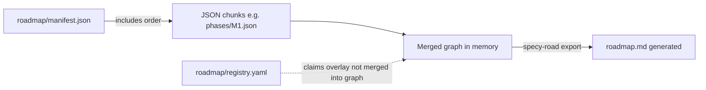

# Prompt: Build specy-road roadmap, registry, and planning from existing project notes

Copy everything below the line into your agentic coding tool. Replace `[REPO_ROOT]` with your repository root if you use absolute paths.

---

You are migrating **roadmap-like** information from an existing project into **specy-road’s** strict layout: a **merged JSON graph** under `roadmap/`, a **registry** for active claims, and **planning** feature sheets (one `planning/*.md` per node with `planning_dir`).

## Authoritative references

1. **`specy-road init project --dry-run`** — Lists every scaffold path; use as checklist.
2. **`docs/roadmap-authoring.md`** — Manifest, chunks, immutability, line limits, planning feature sheets.
3. **`docs/git-workflow.md`** — Register on the integration branch, then `feature/rm-<codename>`, touch zones.
4. **JSON Schema** (consumer copy under `schemas/`): `roadmap.schema.json`, `manifest.schema.json`, `registry.schema.json`. These are copied in by `init project` and do **not** follow toolkit upgrades — if `specy-road validate` warns that a schema is behind, run **`specy-road upgrade`** (in order: `refresh-schemas`; `refresh-profiles`, which adds missing `model-profiles/` files without overwriting; copies any shipped `docs/` file the `AGENTS.md` load order names and the repo lacks; `refresh-stubs`, re-applying the managed blocks, with `--prune` deleting stubs this version no longer installs; then `validate` and `digest --check`. It never touches the roadmap or planning sheets, and `--dry-run` stops before writing. Never `init project --force`, which rewrites the whole scaffold). The IDE stubs from `specyrd init` have the same problem and the same fix, never `specyrd init --force`.

## Mental model (do not confuse these)



- **`roadmap/manifest.json`** — `version: 1` and `includes`: ordered list of chunk paths **relative to `roadmap/`**. Do **not** put `nodes` in the manifest.
- **Chunk files** — JSON containing a `nodes` array (or shapes the loader accepts per `docs/roadmap-authoring.md`). Split large graphs across multiple chunks for git-friendly diffs; respect line limits in `constraints/file-limits.yaml`.
- **`roadmap/git-workflow.yaml`** — Machine defaults for integration branch and remote (CLI + PM Gantt). Edit to match your trunk (e.g. `dev` vs `main`). Every other key is optional; the authoritative list, with each key's default and meaning, is the scaffolded **`schemas/git-workflow.schema.json`** (`additionalProperties: false`, so `validate` rejects a key it does not list), explained in `docs/git-workflow.md`. Decide two of them explicitly: **`on_complete`** (`pr`, `merge` or `auto`: how **`finish-this-task`** lands work; write it rather than relying on the `pr` default, because **`specy-road grind-session`** refuses to start in `pr` mode) and **`require_implementation_review_before_finish`** (when `true`, **`specy-road mark-implementation-reviewed`** must close the review gate against `roadmap/orchestration.yaml` before **`finish-this-task`**; see `docs/orchestration.md`). Know one default: **`require_implementation_before_finish`** is `true`, so `finish-this-task` refuses a node whose branch changed no file under its `touch_zones` (set it `false`, or pass `--allow-empty-implementation`, for a leaf that needs no code change). Quote string values that YAML would otherwise read as booleans: write `track_worker_logs: "off"` (a bare `off` parses as `false`, which the schema happens to accept; `on`/`yes` would not). The PM Gantt UI's `pm_gui.integration_branch_auto_ff` and `pm_gui.registry_remote_overlay` are **not** keys of this file: they are per-user PM GUI settings in `~/.specy-road/gui-settings.json` (the GUI's **Settings** panel).
- **`roadmap/registry.yaml`** — `version: 1`, `entries: []` or active rows. **Not** part of `includes`. Records in-progress work (codename, `node_id`, branch, `touch_zones`, optional `started`, `owner`, optional `node_key`). When **`require_implementation_review_before_finish`** is enabled, each row may include **`implementation_review`**: `pending` | `approved`, and optional **`implementation_review_at`** after approval.
- **`roadmap/orchestration.yaml`** — `version: 1`; optional (a missing file means the default). **`roster`** entries need **`id`**, **`family`** and **`roles`** (`coordinator` | `executor` | `reviewer`); the scaffold default is one `human` reviewer. **`policy`** sets review requirements (`reviewers_required` defaults to 1) and **`substitutions`** swap a roster slot temporarily. For every optional roster, policy and substitution key, read the scaffolded **`schemas/orchestration.schema.json`** (it is authoritative and rejects unknown keys) and the toolkit's `docs/orchestration.md`; do not copy a key list from elsewhere. Do not invent models the team does not use; add a roster entry only for a model that will actually review. Review hand-offs live under gitignored `work/reviews/<NODE_ID>/`.
- **`roadmap/archive/`** — Written only by `specy-road archive` / `restore-archive`; do **not** hand-author it. Holds `index.json` (the ledger of archived subtrees, which `validate` consults so live nodes may keep depending on archived work — **never delete it**), plus the archived chunks, planning sheets, deep-archive bundles and reference files. Not part of `includes`. Commit it like any other roadmap file. See the toolkit's `docs/archiving.md`.
- **`roadmap.md` at repo root** — **Generated** by `specy-road export`. Do not maintain it by hand as the source of truth.

## Phase 1 — Discovery

Find and consolidate:

- `ROADMAP.md`, epics, release plans, Notion exports, issue milestones, strategy docs.
- Dependencies between initiatives (order, blockers).
- **Touch zones** — repo path prefixes each initiative may change (for milestones and registry).
- **Codenames** for milestones if already named (must match kebab-case pattern used in git workflow: align with `codename` on milestone nodes and `feature/rm-<codename>` branches).

## Phase 2 — Graph rules (must satisfy validator)

After merge, every node must conform to `schemas/roadmap.schema.json` (validated on the **merged** graph).

**The scaffold's own nodes.** `init project` ships phase **M1** *Adopt specy-road* and task **M1.1** *Set up the project's specy-road basics* (`project-setup`), whose acceptance criteria are the setup this migration completes. Keep them: put the migrated work in new phases (`M2`, …) or under M1, and mark M1.1 `Complete` through the normal review and finish once its criteria hold. Do not rename them into project work.

### Required on each node

- **`id`** — Display id, pattern `M[0-9]+(\.[0-9]+)*` (e.g. `M1`, `M1.2`). **Immutable**; never renumber existing ids (gaps allowed).
- **`node_key`** — Stable **UUID** (lowercase hex with hyphens). Used in **`dependencies`** and optionally in registry.
- **`type`** — One of: `vision`, `phase`, `milestone`, `task`, `gate` (see `docs/roadmap-authoring.md` for Gate — PM hold, not dev pickup).
- **`title`** — Non-empty string.

### Dependencies

- **`dependencies`** — Array of **`node_key`** UUID strings (depends-on), **not** display `id` strings. A dependency on a **phase or milestone** is satisfied when that node's leaf descendants are all `Complete` (the F-013 rollup), not when its own `status` field says so.

### Nodes with planning (vision, phase, milestone, task, gate)

- Set **`planning_dir`** — Repo-relative path to **one** Markdown file, e.g. `planning/M1.1_slug_<node_key>.md`. **Required** for `vision`, `phase`, `milestone`, `task`, and `gate` per validation. Filename pattern is described in `planning/README.md` (identity is in the filename, not required YAML frontmatter).

### Common optional fields

- `parent_id`, `sibling_order`, `status`, `notes`, `codename`, `touch_zones`, `sensitivity` (default `public`; must match a roster `may_process` value), `executor_eligibility` (`any` or a roster `class` tag), `parallel_tracks`, `execution_milestone`, `goal`, `acceptance` (with the review gate on, `validate` warns on open leaves without it; a criterion only a person can satisfy starts with `human:`, reviewers mark it `n/a`, and `finish-this-task` refuses the leaf until the planning sheet records an `A#: <decision, who and when>` line — see `docs/roadmap-authoring.md`), `planned_test_changes` (test removals or weakenings the leaf is approved to make, each a finding line exactly as `specy-road integrity` prints it; authored and approved with the leaf before pickup, the only way such a change passes the gate when `policy.integrity_gate` is on), `risks`, `decision`.
- **`execution_milestone`** (`Human-led` / `Agentic-led` / `Mixed`) is **advisory** metadata. It does **not** keep a leaf out of `specy-road do-next-available-task`. To hold work until a person clears it, add a **`type: gate`** node and depend on it.
- **`status: "Blocked"`** on a leaf **promotes** it to the top of the pickup queue (a blocked leaf is the one most worth unblocking). Do not use it to mean "do not pick this up" — use a gate dependency.
- **Do not author `agentic_checklist` or `execution_subtask`.** Both are deprecated and absent from `schemas/roadmap.schema.json`; `specy-road validate` strips them from chunk files. Put the contract a node conforms to in its planning sheet's `## References`, cited by filename (`shared/api-contract.md`) — that is what `specy-road brief` reads and inlines.

### Root `vision.md` vs graph

- **`vision.md`** at repo root is separate Markdown. A roadmap **`type: "vision"`** node is optional and is **not** the same artifact—see `docs/roadmap-authoring.md` vocabulary.

## Phase 3 — Registry

- Start from **`roadmap/registry.yaml`** with `version: 1` and `entries: []` unless migrating active work.
- Each active entry: **`codename`**, **`node_id`**, **`branch`** (`feature/rm-<codename>`), **`touch_zones`** (non-empty array), optional **`node_key`**, **`started`**, **`owner`**, and when the implementation-review gate is on: **`implementation_review`** — see `schemas/registry.schema.json` and `docs/git-workflow.md` (register on the **integration branch**, then `feature/rm-*`; remove entry before merge).

## Phase 4 — Planning feature sheets

For every `planning_dir` you reference:

1. Create `planning/<id>_<slug>_<node_key>.md` with content derived from existing docs (or run **`specy-road scaffold-planning <NODE_ID>`** to create from the package template: **feature-sheet** sections for most types, **gate-sheet** sections for `type: gate`).
2. Ensure the planning file name matches `<id>_<codename_slug>_<node_key>.md` (see `planning/README.md`).

## Phase 5 — Export and limits

- Run **`specy-road export`** / **`specy-road export --check`** so **`roadmap.md`** is generated and consistent.
- Keep **`manifest.json`** small; keep each chunk under line limits unless a single-node exception applies per `docs/roadmap-authoring.md` and `constraints/file-limits.yaml` (`roadmap_manifest_max_lines`, `roadmap_json_chunk_max_lines`).

## Phase 6 — Verification

From `[REPO_ROOT]`:

```bash
specy-road validate
specy-road export --check
specy-road digest --check
specy-road file-limits
```

Resolve all errors before finishing. Prefer splitting oversized JSON chunks or adjusting `file-limits.yaml` only when consistent with team policy.

## Non-goals

- Inventing a YAML “merged roadmap” file as the graph source.
- Storing active claims only in chat—use `registry.yaml` for in-progress registration per `docs/git-workflow.md`.
