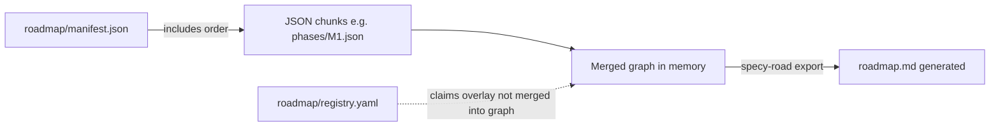

# Prompt: Build specy-road roadmap, registry, and planning from existing project notes

Copy everything below the line into your agentic coding tool. Replace `[REPO_ROOT]` with your git root if you use absolute paths.

---

You are migrating **roadmap-like** information from an existing project into **specy-road’s** strict layout: a **merged JSON graph** under `roadmap/`, a **registry** for active claims, and **planning** feature sheets (one `planning/*.md` per node with `planning_dir`).

Adoption order, stated the same way in every suggested prompt: `specy-road init project`, then governance (`bootstrap-governance.md`), then this prompt, then agent entrypoints (`bootstrap-agents-md.md`, a merge — init already wrote `AGENTS.md`), then brainstorm (`brainstorm-roadmap.md`) any time after the roadmap exists.

Paths such as `roadmap/` and `planning/` are relative to the **project root**. In the embedded layout that root is the git root. In the nested layout (the tree under `sr/`) it is the directory `.specyrd/manifest.json` records as `project_root`. Run every `specy-road` command from the **git root**; the CLI resolves the project root, including a nested one, with no extra flag. Do not create a second `roadmap/` at the git root of a nested repo. `specy-road init project sr` is how a nested tree is scaffolded.

## Authoritative references

1. **`specy-road init project --dry-run`** lists every scaffold path. It prints paths, not contents. Run `specy-road init project` to write the files.
2. **Toolkit docs are not in an adopter repo** unless named here as shipped. `specy-road init project` ships only `docs/supply-chain-security.md` and `docs/model-profiles-research-notes.md`. This prompt's `docs/roadmap-authoring.md`, `docs/git-workflow.md`, `docs/orchestration.md` and `docs/archiving.md` are in the toolkit repository, https://github.com/shanevigil/specy-road/tree/main/docs . `specy-road upgrade` copies a `docs/` file only when `.specyrd/AGENTS.md`'s load order names it and the repo lacks it.
3. **JSON Schema**, shipped by `init project` under `schemas/` and in the installed package at `specy_road/templates/project/schemas/`: `roadmap.schema.json`, `manifest.schema.json`, `registry.schema.json`, `git-workflow.schema.json`, `orchestration.schema.json`. These copies do not follow toolkit upgrades. When `specy-road validate` warns that a schema or stub is behind, run:

```bash
specy-road upgrade --only schemas
specy-road upgrade --only profiles
specy-road upgrade --only stubs
specy-road validate
specy-road digest --check
```

`--dry-run` stops before writing. Never `specy-road init project --force` to refresh schemas, and never `specyrd init --force` to refresh stubs.

## Mental model (do not confuse these)



- **`roadmap/manifest.json`** — `version: 1` and `includes`: ordered chunk paths **relative to `roadmap/`**. Do **not** put `nodes` in the manifest.
- **Chunk files** — JSON `nodes`, written by the CLI below. The shapes the loader accepts are the toolkit's `docs/roadmap-authoring.md`.
- **`roadmap.md`** at the project root is **generated** by `specy-road export`. Do not maintain it by hand.

## Create nodes with the CLI

Do not hand-write chunk JSON, `node_key` UUIDs, or planning filenames. From the git root:

```bash
specy-road add-node --id M2 --parent-id null --type phase --title "…"
specy-road add-node --id M2.1 --parent-id M2 --type task --title "…" --touch-zone src/ --dependency M1.1
specy-road edit-node M2.1 --add acceptance="…"
specy-road planning scaffold M2.1
```

`specy-road add-node` allocates the `node_key`, routes the chunk, and keeps `includes` in order. Repeat `--touch-zone`, `--dependency` (a display id or a `node_key`; stored as the `node_key`) and `--acceptance`. `specy-road edit-node` patches fields (`--set`, `--add`, `--remove`). `specy-road planning scaffold` writes `planning/<id>_<slug>_<node_key>.md` from the package template (feature-sheet, or gate-sheet when `type` is `gate`) and sets `planning_dir`. Fill that sheet from existing notes. Field rules live in `schemas/roadmap.schema.json` and the toolkit's `docs/roadmap-authoring.md`; do not copy them into the chunk by hand.

**The scaffold's own nodes.** `init project` ships phase **M1** *Adopt specy-road* and task **M1.1** *Set up the project's specy-road basics*. Keep them. Put migrated work in new phases (`M2`, …) or under M1, and mark M1.1 `Complete` through review and `specy-road finish-this-task` once its criteria hold. Display ids (`M` plus dotted numbers) are immutable.

A dependency on a phase or milestone is satisfied when that node's leaves are all `Complete`. `execution_milestone` does not hold a leaf out of `specy-road do-next-available-task`; a `type: gate` node does. `status: "Blocked"` promotes a leaf in the pickup queue; it does not mean "leave this unclaimed". Do not author `agentic_checklist` or `execution_subtask`. With the review gate on, `specy-road validate` warns when an open leaf has no `acceptance`. A criterion only a person can satisfy starts with `human:`; closing it is `specy-road decisions add --kind human-action`, not a line on the planning sheet.

`vision.md` at the project root is not a roadmap `type: "vision"` node. See the toolkit's `docs/roadmap-authoring.md`.

## Registry and the other roadmap files

- Start `roadmap/registry.yaml` at `version: 1` and `entries: []` unless an active claim is being migrated. Register on the integration branch, then `feature/rm-<codename>`, and remove the row before merge (toolkit `docs/git-workflow.md`). `specy-road do-next-available-task` and `specy-road finish-this-task` write the row; do not hand-edit it to claim work.
- **`roadmap/git-workflow.yaml`** — set the integration branch to this repo's trunk. The key list, with defaults, is the scaffolded `schemas/git-workflow.schema.json` (unknown keys fail validate), explained in the toolkit's `docs/git-workflow.md`. Decide two keys yourself: `on_complete` (`pr`, `merge` or `auto`; `specy-road grind-session` refuses to start when it is `pr`) and `require_implementation_review_before_finish` (when true, `specy-road mark-implementation-reviewed` must pass against `roadmap/orchestration.yaml` before finish). `require_implementation_before_finish` defaults to true, so finish refuses a leaf whose branch changed nothing under its `touch_zones`. Quote values YAML would read as booleans: `track_worker_logs: "off"`. `pm_gui.integration_branch_auto_ff` and `pm_gui.registry_remote_overlay` are not keys of this file; they are per-user settings in `~/.specy-road/gui-settings.json`.
- **`roadmap/orchestration.yaml`** — optional (`version: 1`; missing means one human reviewer). Roster entries need `id`, `family` and `roles`. Add a model only if the team will use it. Keys: `schemas/orchestration.schema.json` and the toolkit's `docs/orchestration.md`.
- **`roadmap/archive/`** — written only by `specy-road archive` and `specy-road restore-archive`. Do not hand-author it, and never delete `index.json`. See the toolkit's `docs/archiving.md`.

## Verification

From the git root:

```bash
specy-road validate
specy-road export --check
specy-road digest --check
specy-road file-limits
```

Resolve every error and every warning before finishing, not errors alone. A run that exits 0 can still print touch-zone overlap warnings and milestone-review notices; fix those too. When a warning says a schema or stub is behind, run `specy-road upgrade` as in the references above. Prefer splitting an oversized chunk over raising a cap in `constraints/file-limits.yaml`, unless that is the team's policy.

## Non-goals

- Hand-writing chunk JSON, or inventing a YAML file as the merged graph, where `specy-road add-node`, `specy-road edit-node` and `specy-road planning scaffold` exist.
- Storing active claims only in chat. Use `roadmap/registry.yaml`, as the toolkit's `docs/git-workflow.md` describes.
